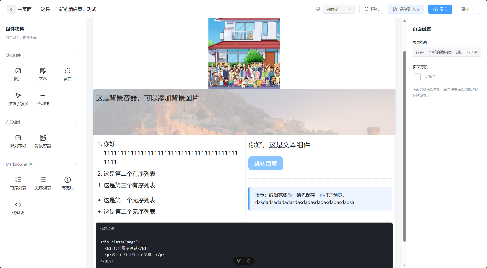
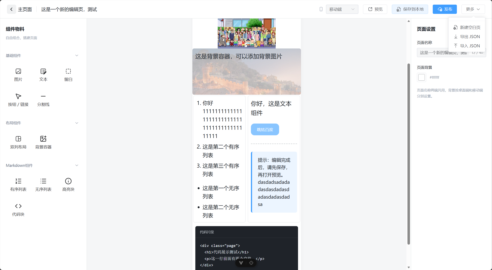
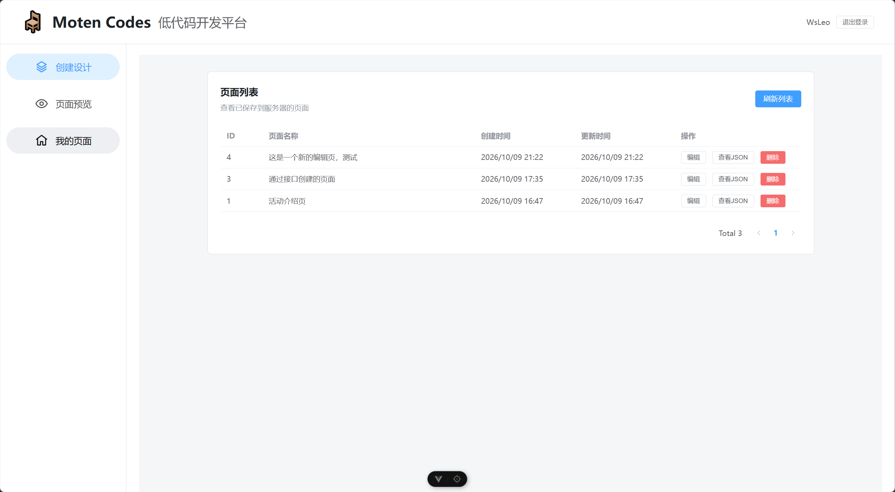
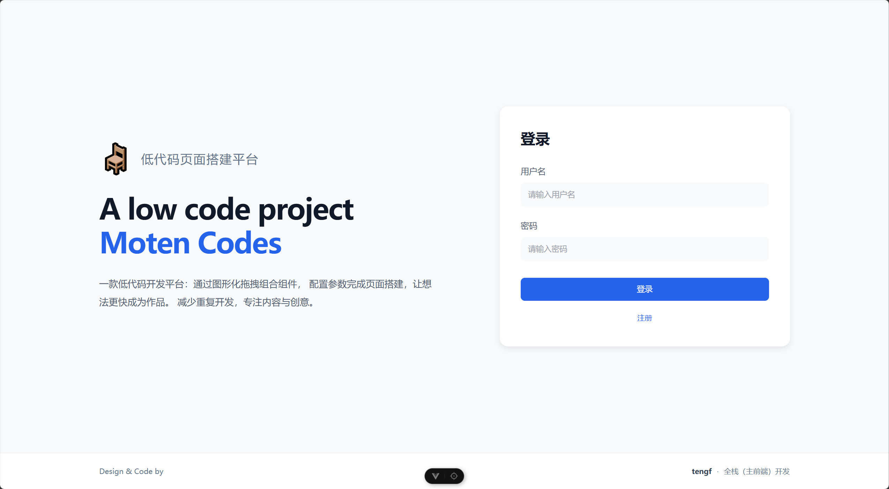
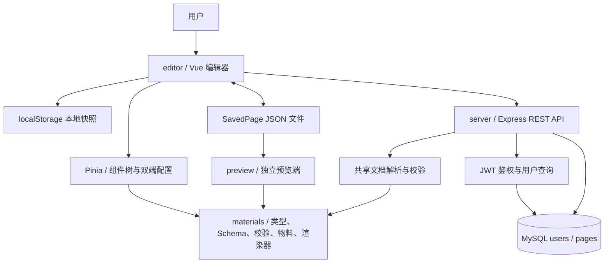

<h1 align="center">Moten Codes · 可视化低代码页面搭建平台</h1>

<p align="center">拖拽搭建 · Schema 驱动配置 · 桌面 / 移动双端 · 共享物料渲染 · 全栈页面管理</p>

<p align="center">
  
</p>

Moten Codes 是一个基于 **Vue 3 + TypeScript + Express + MySQL** 的低代码页面搭建学习项目。用户可以拖入物料、调整属性、分别配置桌面和移动端效果，再通过 JSON 导入导出、本地保存或数据库草稿保存管理页面。

项目采用 **pnpm Workspace Monorepo**，将编辑器、物料与文档协议、独立预览端、服务端拆为四个包。重点在于打通「组件树 → 属性配置 → 校验 → 保存 → 渲染」的数据链路，以及登录状态与页面 CRUD 的前后端协作。


## 快速了解

| 关注点 | 已实现内容 |
| --- | --- |
| 可视化编辑 | 三栏编辑器、物料拖入、画布排序、选中与属性配置、容器内放置基础物料 |
| 物料体系 | 11 种物料，包含基础组件、两种容器、列表与代码展示组件 |
| 多端配置 | 属性按 `desktop` / `mobile` 保存，切换视口读取相应配置 |
| 数据协议 | `SavedPage` v1 JSON 文档，包含页面名称、组件树和页面配置 |
| 数据校验 | TypeBox 定义配置 Schema，AJV 校验属性，共享 `parsePage` 校验文档结构 |
| 持久化 | 手动本地保存、JSON 文件导入导出、MySQL 草稿 CRUD 与分页列表 |
| 预览 | 编辑器内读取本地快照；独立预览应用导入 JSON，无需后端即可查看示例 |
| 账号与会话 | 注册、登录、JWT 鉴权、恢复会话、过期处理、旧会话响应拦截 |
| 工程组织 | pnpm 多包管理、共享类型与组件、Vue / TypeScript 类型检查、Vite 构建 |

## 项目截图

以下为项目操作截图；截图中的示例内容属于展示数据。

### 桌面端编辑器

左侧选择物料，中间拖拽搭建，右侧配置选中组件或页面属性。



### 移动端编辑视口

切换移动端视口后，可独立配置相应的文字、图片和布局表现。



### 页面管理

页面列表展示名称、创建与更新时间，并提供编辑、删除和分页操作。



### 登录界面



## 技术栈

版本范围来自各包的 `package.json`，具体解析版本以 `pnpm-lock.yaml` 为准。

| 层级 | 技术 | 用途 |
| --- | --- | --- |
| UI 框架 | Vue `^3.5.42`、Composition API、单文件组件 | 编辑器与预览端界面、物料组件 |
| 类型系统 | TypeScript `~6.0.0`、vue-tsc | 页面协议、组件属性、接口类型和 Vue 类型检查 |
| 构建工具 | Vite `^8.2.2`、Vue 插件、Vue DevTools | 开发服务、模块处理和生产构建 |
| 状态与路由 | Pinia `^4.0.3`、Vue Router `^5.3.1` | 编辑状态、用户状态、路由守卫 |
| UI 与图标 | Element Plus `^2.14.7`、Iconify Vue `^4.1.2` | 表单、上传、弹窗、分页及操作图标 |
| 拖拽与数据 | vuedraggable `^4.1.0`、lodash `^4.17.21`、nanoid `^5.0.7` | 拖拽排序、深拷贝物料、生成节点 ID |
| Schema | TypeBox `^0.32.31`、AJV `^8.20.0` | 配置结构定义、属性与页面校验 |
| 服务端 | Node.js、Express `^4.22.3`、tsx `^4.23.15` | REST API、复用共享 TypeScript 文档解析模块 |
| 数据库 | MySQL、mysql2 `^3.24.5` | 连接池、参数化查询、JSON 草稿存储 |
| 认证 | jsonwebtoken `^9.0.3`、Node.js crypto / scrypt | JWT 签发验证、带随机盐的密码哈希 |
| 请求控制 | express-rate-limit `^8.7.1`、cors `^2.8.6` | 登录/注册限流和跨域支持 |
| 工程与测试 | pnpm `12.6.0`、Node.js 内置 Test Runner、Vite SSR | Workspace 管理、现有鉴权回归测试 |

## 系统架构



服务端通过 `@learn-moten/materials/document` 子路径复用文档解析和校验逻辑，无需加载 Vue 组件。预览端与编辑器则复用物料组件和页面渲染器。

### 目录结构

```text
moten-Codes/
├─ docs/
│  ├─ images/                      # README 中的四张截图
│  ├─ API.md                       # 请求、响应与错误说明
│  └─ VALIDATION.md                # 发布副本验证记录
├─ examples/
│  └─ welcome-page.json            # 可导入编辑器/预览端的示例
├─ packages/
│  ├─ editor/
│  │  ├─ src/api/                  # 请求封装、认证与页面接口
│  │  ├─ src/components/config/    # Schema 对应的属性表单控件
│  │  ├─ src/components/edit/      # 拖拽、画布、选中与配置面板
│  │  ├─ src/config/block.ts       # 物料默认配置
│  │  ├─ src/pages/                # 登录、首页、编辑、预览、页面列表
│  │  ├─ src/router/               # 路由与会话守卫
│  │  ├─ src/stores/               # 编辑/用户状态
│  │  ├─ src/utils/                # 本地存储、文件下载
│  │  └─ tests/                    # 前端鉴权与请求行为测试
│  ├─ materials/
│  │  └─ src/
│  │     ├─ components/            # 11 种物料组件
│  │     ├─ render/                # 共享递归页面渲染
│  │     ├─ types.ts               # BaseBlock、SavedPage、Viewport
│  │     ├─ schema.ts              # TypeBox 配置定义
│  │     ├─ validate.ts            # AJV 校验和定位错误
│  │     ├─ document.ts            # JSON 解析与结构校验
│  │     └─ registry.ts            # 物料注册
│  ├─ preview/                    # JSON 导入式独立预览应用
│  └─ server/
│     ├─ src/index.js              # REST API 与服务入口
│     ├─ src/db.js                 # MySQL 连接池
│     ├─ src/password.js           # scrypt 密码处理
│     ├─ src/middleware/auth.js    # Bearer JWT 鉴权
│     ├─ src/routes/register.js    # 注册接口
│     ├─ scripts/init-user.js      # 可选本地账号初始化
│     ├─ sql/init.sql              # 与当前接口匹配的开发建表脚本
│     ├─ tests/                    # 服务端鉴权与页面接口测试
│     └─ .env.example              # 配置模板，不包含真实凭据
├─ package.json
├─ pnpm-workspace.yaml
└─ pnpm-lock.yaml
```

## 本地运行

### 环境要求

- Node.js 满足项目声明的 `^22.18.0 || >=24.12.0`。
- pnpm `12.6.0`；锁文件包含该版本使用的多段 YAML 格式，请使用项目指定版本安装。
- 完整编辑流程需要 MySQL，建议使用支持 JSON 列的 MySQL 8.x。
- 只体验独立预览端时，不需要 MySQL、账号或服务端 `.env`。

### 1. 获取代码与安装依赖

```bash
git clone https://github.com/11fengt/moten-Codes.git
cd moten-Codes
corepack enable
corepack prepare pnpm@12.6.0 --activate
pnpm install --frozen-lockfile
```

如果系统已安装对应版本 pnpm，可以跳过 Corepack 两行命令。Windows 若提示 `pnpm.ps1` 无法执行，可在 PowerShell 中把 `pnpm` 写为 `pnpm.cmd`。

### 2. 不依赖数据库的快速预览

```bash
pnpm dev:preview
```

打开 `http://localhost:5175`，选择导入文件 `examples/welcome-page.json`，切换桌面 / 移动视口查看效果。也可以导入编辑器导出的 JSON。

### 3. 初始化开发数据库

使用 MySQL Workbench、DBeaver 等客户端执行 [init.sql](packages/server/sql/init.sql)。如果使用 MySQL 命令行客户端，先登录，再执行以下命令；将路径替换成你的实际项目路径，Windows 路径可用 `/`：

```sql
SOURCE D:/your-project/moten-Codes/packages/server/sql/init.sql;
```

脚本创建 `moten_codes` 数据库、`users` 和 `pages` 表，不包含用户密码或演示账号，也不会删除已有数据。`CREATE TABLE IF NOT EXISTS` 不会自动迁移已有的不兼容表。

### 4. 配置服务端

PowerShell：

```powershell
Copy-Item packages/server/.env.example packages/server/.env
node -e "console.log(require('node:crypto').randomBytes(48).toString('base64url'))"
```

把生成的随机字符串写到本机 `.env` 的 `JWT_SECRET`，再填写数据库连接信息。macOS / Linux 可用 `cp` 代替 `Copy-Item`。

| 配置项 | 说明 |
| --- | --- |
| `DB_HOST` | MySQL 主机，例如 `127.0.0.1` |
| `DB_PORT` | MySQL 端口，例如 `3306` |
| `DB_USER` | 本机数据库用户 |
| `DB_PASSWORD` | 本机数据库密码 |
| `DB_NAME` | 默认建表脚本使用 `moten_codes` |
| `JWT_SECRET` | 必填随机密钥，服务端要求至少 32 个 UTF-8 字节 |
| `INIT_USERNAME` | 可选，初始化账号脚本使用；3～32 位字母、数字或下划线 |
| `INIT_PASSWORD` | 可选，初始化账号脚本使用；12～128 个字符 |

服务端目前固定监听 `8082`，没有读取 `PORT` 环境变量。`.env` 已加入忽略规则，请只提交 `.env.example`。

### 5. 启动完整应用

在项目根目录打开两个终端：

```bash
# 终端 1：后端
pnpm dev:server
```

```bash
# 终端 2：编辑器
pnpm dev
```

| 应用 | 默认地址 | 说明 |
| --- | --- | --- |
| 编辑器 | `http://localhost:5173` | Vite 默认端口；被占用时以终端输出为准 |
| 服务端 | `http://localhost:8082` | Express API |
| 独立预览端 | `http://localhost:5175` | 需另运行 `pnpm dev:preview`；端口被占用会报错 |

编辑器的 Vite 配置将 `/api` 代理到 `http://localhost:8082`。在登录页面注册本地账号，然后登录。注册不会自动登录。

也可以在 `.env` 填写 `INIT_USERNAME` / `INIT_PASSWORD` 后手动创建账号：

```bash
pnpm --filter @learn-moten/server init:user
```

该脚本创建 `editor` 账号，遇到重复用户名会报错，不会覆盖原密码。

### 6. 推荐体验路径

1. 注册、登录，进入首页或页面管理。
2. 新建页面，拖入文本、图片、按钮与双列容器。
3. 选中组件，修改右侧配置，切换移动端再次设置属性。
4. 点击本地保存，再进入编辑器内预览查看最新快照。
5. 导出 JSON，并在独立预览端导入同一文件。
6. 点击“发布”保存数据库草稿，在页面列表打开、修改、再次保存或删除。

## 物料与编辑机制

### 内置物料

| 分类 | 物料 code | 主要配置 |
| --- | --- | --- |
| 基础 | `text` | 文本、字号、颜色 |
| 基础 | `image` | 图片地址、宽度、高度 |
| 基础 | `blank` | 留白高度 |
| 基础 | `button` | 文字、HTTP(S) 跳转地址、字号、颜色 |
| 基础 | `divider` | 颜色、粗细、线型、上下间距 |
| 布局 | `column` | 固定两组子节点，分别表示两列 |
| 布局 | `backgroundContainer` | 背景图片、最小高度、内边距、一组子节点 |
| 内容 | `orderedList` | 按行输入有序列表、字号、颜色 |
| 内容 | `unorderedList` | 按行输入无序列表、字号、颜色 |
| 内容 | `highlight` | 提示文本、字号、文字/背景/强调线颜色 |
| 内容 | `codeBlock` | 代码文本、字号、文字和背景颜色 |

列表、高亮和代码块是独立结构化物料，当前未接入完整 Markdown 解析器；代码块展示文本，不执行代码。

### 拖拽与组件树

- 物料被拖入时先深拷贝默认配置，再为整棵子树递归生成节点 ID，避免不同实例共用配置或重复 ID。
- 画布数据使用 `BaseBlock[]`，容器通过 `children: BaseBlock[][]` 保存子区域。
- 双列容器必须有两组子节点，背景容器必须有一组子节点。
- 容器只允许放在根画布，不能再拖入其他容器；基础物料不能包含子节点。
- 查找选中节点和页面渲染均递归访问组件树。

对应实现：[nested.ts](packages/editor/src/components/edit/nested.ts)、[文档校验](packages/materials/src/validate.ts)、[共享渲染器](packages/materials/src/render/page-render-block.vue)。

### Schema 驱动属性配置

`schema.ts` 中的规则既描述数据约束，也包含表单展示元信息，例如 `title`、`code`、`placeholder`、`options`。编辑器根据规则选择输入框、滑块、颜色、下拉和图片控件；AJV 将同一组规则编译为属性校验函数。

保存或导出失败时，错误包含节点 ID 与视口信息，编辑器可切换到对应端并打开配置面板。导入先调用 `parsePage` 校验临时文档，再经用户确认替换当前页面。

### 双端配置

各属性的值按端保存，而不是复制两棵页面树：

```ts
type Viewport = 'desktop' | 'mobile'
type ViewportValue<T> = Record<Viewport, T>

// 例：同一文本组件在两端使用不同字号
const fontSize = { desktop: 28, mobile: 20 }
```

两端共享组件数量、顺序和容器结构，组件渲染时读取 `formData.xxx[viewport]`。这是同一文档的两套属性配置，不是通过媒体查询自动推导所有属性。

### 图片处理

图片控件支持填写 URL，或选择 PNG / JPEG / WebP 本地图片。单张本地图片上限 1 MB，使用 FileReader 转成 Data URL 存入文档；当前没有独立图片上传接口或对象存储服务。多张内嵌图片会增大 JSON、本地存储和请求体体积。

## 页面数据协议

### `SavedPage` v1

```json
{
  "version": 1,
  "pageName": "欢迎页面",
  "content": {
    "block": [
      {
        "id": "welcome-title",
        "code": "text",
        "name": "文本",
        "icon": "text",
        "formData": {
          "text": { "desktop": "Hello, Moten Codes", "mobile": "Hello, Moten" },
          "fontSize": { "desktop": 32, "mobile": 24 },
          "color": { "desktop": "#1f2329", "mobile": "#1f2329" }
        }
      }
    ],
    "page": {
      "background": { "desktop": "#ffffff", "mobile": "#ffffff" }
    }
  }
}
```

完整示例见 [examples/welcome-page.json](examples/welcome-page.json)，可直接导入。

### 校验约束

| 字段/结构 | 当前规则 |
| --- | --- |
| `version` | 固定为 `1`，未提供版本迁移器 |
| `pageName` | trim 后长度 1～40 |
| `id` | 非空字符串，整棵组件树内不可重复 |
| `code` | 必须属于当前支持的 11 种物料 |
| `name` / `icon` | 字符串；`formData` 为对象 |
| `page.background` | 同时包含字符串类型 `desktop` / `mobile` |
| 容器 | 根层级、`nested: true`、子区域数量满足物料要求 |
| 属性 | 两端均校验，例如字号 12～52、留白高度 8～200、链接以 HTTP(S) 开头 |

`parsePage` 先解析 JSON 和检查文档结构，再递归调用 `validateDocument` 检查页面与物料属性。编辑器导入、本地快照恢复、独立预览以及服务端创建/更新页面复用该入口。

### 三种保存方式

| 方式 | 存储位置 | 特点 |
| --- | --- | --- |
| 本地保存 | localStorage `learn-moten:document:v1` | 手动保存，按浏览器源隔离，编辑器内预览读取这个快照 |
| JSON 导入导出 | 本地文件 | 可迁移、可分享，导入前校验，通过确认后替换当前文档 |
| “发布” | MySQL `pages.draft_content` | 首次 POST 创建，已有 ID 时 PUT 更新；成功后同步本地预览快照 |

编辑器内预览不会自动读取所有未保存修改。保存期间如果用户切换或新建文档，旧请求返回的 ID 不会被绑定到新文档。当前没有自动保存、撤销重做、多人协同或版本历史。

## 账号、鉴权与请求处理

1. 用户提交账号密码，服务端根据用户名查询数据库并验证 scrypt 哈希。
2. 登录成功签发 HS256 JWT，有效期 2 小时，载荷使用用户 ID。
3. 前端将 token 保存于 sessionStorage，页面请求附加 `Authorization: Bearer <token>`。
4. 刷新或进入受保护页面时通过 `/api/auth/me` 恢复当前用户。
5. 服务端校验 token、过期时间与用户 ID，并重新查询当前用户是否存在。
6. 请求封装统一处理 401、非 JSON 响应、请求体过大和会话切换后的旧响应。

前端维护 `sessionVersion`，用户退出或重新登录后递增；异步响应只有仍属于当前会话才会被接受，避免旧账号的延迟响应污染新会话。并发 401 也会合并处理过期跳转。

密码通过随机盐 + scrypt 派生后保存，验证使用 `timingSafeEqual`。当前登录限流为每 IP 每分钟 10 次，注册为 5 次。用户角色会随接口返回，但尚未实现按角色限制管理操作。

## API 概览

开发环境 Base URL 为 `http://localhost:8082`。JSON 请求设置 `Content-Type: application/json`；鉴权接口还需 `Authorization: Bearer <token>`。

| 方法 | 路径 | 鉴权 | 作用 |
| --- | --- | --- | --- |
| GET | `/api/health` | 否 | 服务进程健康检查，不验证数据库 |
| GET | `/api/health/db` | 是 | 查询页面总量，检查数据库连接 |
| POST | `/api/auth/register` | 否 | 注册 `editor` 用户 |
| POST | `/api/auth/login` | 否 | 登录，返回 token 和用户 |
| GET | `/api/auth/me` | 是 | 查询当前用户 |
| POST | `/api/pages/receive` | 是 | 调试用数据接收，不持久化 |
| POST | `/api/pages` | 是 | 校验并创建页面草稿 |
| GET | `/api/pages?page=1&size=10` | 是 | 分页列表，ID 倒序 |
| GET | `/api/pages/:id` | 是 | 返回完整页面文档 |
| PUT | `/api/pages/:id` | 是 | 使用完整文档更新页面 |
| DELETE | `/api/pages/:id` | 是 | 删除页面 |

### 创建 / 更新页面

请求体直接提交上述 `SavedPage` 对象，不需要额外包裹 `data`。创建成功返回 HTTP 201：

```json
{
  "message": "页面创建成功",
  "data": { "id": 1, "pageName": "欢迎页面" }
}
```

### 页面列表

`page` 默认 1，`size` 默认 10；`page` 为正安全整数，`size` 范围 1～100。重复数组参数与过大的分页偏移会被拒绝。

```json
{
  "message": "页面列表查询成功",
  "data": {
    "list": [
      { "id": 1, "name": "欢迎页面", "createdAt": "2026-01-01T00:00:00.000Z", "updatedAt": "2026-01-01T00:00:00.000Z" }
    ],
    "total": 1,
    "page": 1,
    "size": 10
  }
}
```

### 错误处理

| 状态码 | 常见含义 |
| --- | --- |
| 400 | 参数、页面 ID、分页或文档校验失败 |
| 401 | 登录失败、缺少凭证、token 无效/过期、用户不存在 |
| 404 | 页面不存在 |
| 409 | 注册用户名重复 |
| 413 | JSON 请求体超过 Express 的 5 MB 限制 |
| 429 | 登录/注册请求超过当前限流 |
| 500 | 数据库或服务器错误 |

业务错误一般返回 `{ "message": "错误说明" }`；解析 JSON 和请求体超限等 Express 默认错误未统一为同一 JSON 格式，前端对此有非 JSON 响应处理。完整请求、响应和 PowerShell 调用示例见 **[API 文档](docs/API.md)**。

## 数据库设计

| 表 | 字段 | 用途 |
| --- | --- | --- |
| `users` | `id`、`username`、`password_hash`、`role`、时间戳 | 用户认证，用户名唯一 |
| `pages` | `id`、`name`、`draft_content`、时间戳 | JSON 草稿与列表元信息 |

服务端使用 mysql2 Promise 连接池（上限 5），CRUD 查询使用占位符传参。`draft_content` 保存完整文档，避免每新增一个物料属性都修改关系表字段。

当前 `pages` 没有 `owner_id`，所有通过鉴权的账号可以访问同一批页面。因此界面“我的页面”属于当前演示文案，尚未具备用户级数据隔离。

## 检查、测试与构建

```bash
# 全工作区类型检查
pnpm type-check

# 编辑器 + 预览端构建
pnpm build

# 现有前端与服务端鉴权回归测试
pnpm --filter @learn-moten/editor test:auth
pnpm --filter @learn-moten/server test:auth
```

现有测试使用 Node.js 内置 Test Runner：前端经 Vite 加载真实 TypeScript 模块并模拟浏览器存储/HTTP；服务端启动随机本地端口并模拟 MySQL 查询，不读取真实 `.env` 或连接开发数据库。它们验证鉴权、页面请求、过期状态与会话切换等行为，不代表真实数据库集成测试或浏览器端到端测试。

构建产物位于 `packages/editor/dist` 和 `packages/preview/dist`。`materials` 作为共享源码包使用；服务端直接通过 Node.js + tsx 运行，根构建命令不会生成服务端部署包。此次发布副本的实际检查结果见 [验证记录](docs/VALIDATION.md)。

## 部署说明与当前边界

编辑器静态产物可交给静态服务器，但需要配置 Vue Router history 的 SPA 回退，并将 `/api` 反向代理到 Express。Vite 开发代理不会自动带入生产静态文件。后端在设置好本机 `.env` 和数据库后可使用：

```bash
pnpm --filter @learn-moten/server start
```

独立预览端可以作为静态应用运行，仍然通过用户选择 JSON 文件展示页面。仓库当前不包含完整生产运维方案；如继续面向公网使用，应优先补齐以下实际缺口：

- 页面归属字段与用户级授权，避免登录用户之间共享所有页面。
- 草稿 / 发布状态、公开预览路由、发布记录与版本历史。
- Refresh Token、服务端撤销机制和更完整的账号管理。
- 统一 JSON 错误处理、部署环境 CORS 配置及反向代理配置。
- 独立图片存储，避免大量 Data URL 占用 JSON / localStorage。
- 真实 MySQL 集成测试、文档协议测试与浏览器交互测试。

上述为后续方向，不属于当前已经实现的功能。

## 阅读源码的建议顺序

1. [types.ts](packages/materials/src/types.ts)：先了解文档与节点模型。
2. [block.ts](packages/editor/src/config/block.ts) 与 [schema.ts](packages/materials/src/schema.ts)：看物料默认值与配置规则。
3. [nested.ts](packages/editor/src/components/edit/nested.ts) 与 [edit Store](packages/editor/src/stores/edit.ts)：看拖拽克隆和编辑状态。
4. [document.ts](packages/materials/src/document.ts) 与 [validate.ts](packages/materials/src/validate.ts)：看结构校验和属性校验的分工。
5. [请求封装](packages/editor/src/api/request.ts) 与 [用户 Store](packages/editor/src/stores/user.ts)：看鉴权及异步会话处理。
6. [服务端入口](packages/server/src/index.js) 与 [认证中间件](packages/server/src/middleware/auth.js)：看接口、查询及认证链路。
7. [共享渲染器](packages/materials/src/render/page-render-block.vue)：看同一文档在预览端如何渲染。

## License

[MIT](LICENSE)。第三方依赖遵循各自许可证。截图、说明和示例用于展示当前项目实现。
